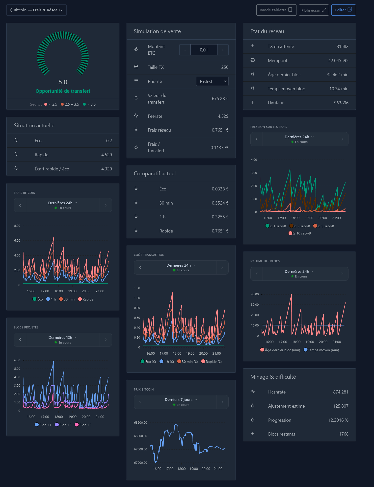

# Bitcoin Monitor for Gladys Assistant

Bitcoin Monitor is a production-oriented external device integration for [Gladys Assistant](https://gladysassistant.com). It discovers five virtual devices that expose Bitcoin fee estimates, projected blocks, mempool pressure, chain and mining data, fiat prices, and a local transaction-cost simulator.

It uses the official [`@gladysassistant/integration-sdk`](https://github.com/GladysAssistant/integration-sdk-js) and the public REST API of [mempool.space](https://mempool.space/docs/api/rest). No account, API key, MQTT setup, Node-RED flow, telemetry, or manually created device is required.

## Features

- Precise fee rates and the first three projected blocks.
- Mempool backlog and fee-rate pressure at 1, 2, 5, and 10 sat/vB.
- Tip height and new-block details fetched only when the height changes.
- Difficulty-adjustment progress and current network hashrate/difficulty.
- BTC price in EUR, USD, GBP, CHF, CAD, AUD, or JPY.
- Persistent transaction simulator using amount, vSize, priority, current fee rates, and public price.
- Conservative, non-overlapping polling with timeout, exponential backoff, jitter, and `Retry-After` support.
- Last-known-good data retention and an application connection status in Gladys.

## Dashboard example

The integration includes five native widget types with twelve views for fees, transaction simulation, mempool pressure, block activity, mining difficulty, and market price. Requires **Gladys 5.1.0 or newer** and SDK 0.14.0.

Add Bitcoin widgets from the dashboard editor. The SDK exposes widget content, not an API to create an entire dashboard or place its cards automatically. The [English setup guide](docs/en.md#integration-widgets) and [French setup guide](docs/fr.md#widgets-de-lintégration) describe the three-column layout matching the reference below.



## Discovered devices

```text
Bitcoin Monitor
├── Bitcoin Fees
├── Bitcoin Mempool
├── Bitcoin Network
├── Bitcoin Market
└── Bitcoin Transaction Simulator
```

Discovery does not create devices behind the user's back. Open the integration's **Discovery** tab and create the devices you want. States are published only for devices and features that exist in Gladys.

## Installation from the decentralized store

After the first public release is indexed:

1. Open **Integrations** in Gladys.
2. Search for **Bitcoin Monitor**.
3. Review the manifest and install it.
4. Configure the currency, polling, and simulator defaults.
5. Open **Discovery** and create the five virtual devices (or only the ones you need).

## Configuration

| Key                       |   Default | Accepted values                   |
| ------------------------- | --------: | --------------------------------- |
| `currency`                |     `EUR` | EUR, USD, GBP, CHF, CAD, AUD, JPY |
| `fast_poll_seconds`       |        60 | 30–900 seconds                    |
| `difficulty_poll_seconds` |       600 | 300–3600 seconds                  |
| `hashrate_poll_seconds`   |      1800 | 600–21600 seconds                 |
| `default_tx_vsize`        |       250 | 50–10000 vB                       |
| `default_priority`        | `fastest` | fastest, half_hour, hour, economy |

The Configuration screen also exposes **Test connection**, **Refresh now**, and **Update transaction simulator** actions.

### Simulator input in Gladys

Gladys does not render a generic writable `sensor/decimal` feature as a numeric input. Bitcoin Monitor maps **Transfer amount (BTC)** to Gladys' supported numeric setpoint contract, with a `0.00000001 BTC` step, so it can be entered directly from a native device card. **Priority** is also directly editable. The integration's **Transaction simulator** widget offers amount, vSize and priority in its settings: press **Apply widget settings** to save them to the shared simulator. The existing **Update transaction simulator** configuration action remains available.

## Transport and freshness

The integration declares the `cloud` transport: public data and simulator estimates depend on mempool.space. Per-device badges show `cloud`, degraded `cloud` when only some sources work, or `unreachable` when none are healthy. Local simulator inputs remain editable during an outage. Badges are republished after reconnecting to Gladys and after device creation or updates.

Healthy unchanged values are republished on the first collection after five minutes to keep constant fees and simulator inputs visible in recent history. Failed or expired sources retain their cached values without publishing them as new measurements; widget values show **Unavailable** until recovery. Opening widgets reads the existing cache and never adds mempool.space requests.

## Simulator semantics

The transferred BTC amount does **not** determine the Bitcoin network fee. The estimate is:

```text
fee_sats = ceil(transaction_vsize × feerate_sat_per_vB)
fee_btc = fee_sats / 100,000,000
fee_fiat = fee_btc × public_BTC_price
```

The local BTC amount is used only to calculate the transfer's fiat value and the percentage represented by the fee. It is persisted in `/data/simulator-state.json` and is never sent to mempool.space.

Published numeric values are rounded before they are sent to Gladys, preventing JavaScript floating-point artifacts:

| Value                          | Precision  |
| ------------------------------ | ---------- |
| BTC price and transfer value   | 2 decimals |
| Fiat fees                      | 4 decimals |
| Feerates                       | 3 decimals |
| Percentages                    | 4 decimals |
| BTC values                     | 8 decimals |
| Satoshis and transaction vSize | Integer    |

Gladys stores these as numbers, so an insignificant trailing zero may be omitted (for example `0.034` instead of `0.0340`), but binary floating-point tails are never published.

## Data sources

- `/api/v1/fees/precise`
- `/api/v1/fees/mempool-blocks`
- `/api/mempool`
- `/api/v1/prices`
- `/api/blocks/tip/height`
- `/api/v1/blocks/:startHeight` only after a height change
- `/api/v1/difficulty-adjustment`
- `/api/v1/mining/hashrate/1m`

## Architecture

```text
index.js                         SDK bootstrap
src/api/mempoolClient.js         HTTP validation, timeout, retry and rate limiting
src/calculations/                Pure fee, mempool, advice and simulation calculations
src/devices/                     Five Gladys discovery/state definitions
src/services/collector.js        Last-known-good cache and batched publication
src/services/scheduler.js        Non-overlapping setTimeout scheduler
src/services/simulatorState.js   Atomic /data persistence
src/integration.js               SDK handlers and lifecycle orchestration
src/widgets.js                   Five native widget types and six history presets
src/services/sourceHealth.js     Per-source freshness and device dependencies
```

## Development

Validated runtime: Node.js **24.22.1 LTS** and npm 11.18.0. The package's
`engines.node >=20` remains a compatibility declaration for existing external
hosts, not a security certification of older runtimes. Use the corrected Node
24 LTS runtime for deployment.

```bash
npm ci
npm run format:check
npm run lint
npm test
```

GitHub Actions runs formatting, lint and the complete test suite (including all localized widget labels) on pull requests and pushes to `main`. It also checks that the Docker image builds with the embedded Gladys manifest, without publishing the image. Run these checks manually from **Actions → CI → Run workflow**. Test results are available in the job logs and as a JUnit artifact retained for one day, including when tests fail. A newer run cancels the previous run for the same pull request or branch.

To connect the integration directly to a development Gladys instance:

```bash
GLADYS_HOST_API_URL="http://localhost:1443" \
GLADYS_INTEGRATION_TOKEN="<token>" \
GLADYS_INTEGRATION_SELECTOR="bitcoin-monitor-dev" \
DATA_DIRECTORY="./data" \
LOG_LEVEL=debug \
npm start
```

The three `GLADYS_*` values are the current environment contract of the official SDK. Register all handlers before connection; the implementation already does this.

## Docker

```bash
BITCOIN_MANIFEST="$(jq -c . gladys-assistant-integration.json)"
docker build \
  --build-arg "GLADYS_INTEGRATION_MANIFEST=${BITCOIN_MANIFEST}" \
  -t bitcoin-monitor:test .
docker run --rm --read-only --user 1000:1000 \
  --tmpfs /tmp:rw,noexec,nosuid,size=16m \
  -v bitcoin-monitor-data:/data \
  -e GLADYS_HOST_API_URL="http://<gladys-host>:<port>" \
  -e GLADYS_INTEGRATION_TOKEN="<token>" \
  -e GLADYS_INTEGRATION_SELECTOR="bitcoin-monitor-dev" \
  bitcoin-monitor:test
```

PowerShell equivalent for the build:

```powershell
$bitcoinManifest = Get-Content gladys-assistant-integration.json -Raw |
  ConvertFrom-Json |
  ConvertTo-Json -Compress -Depth 100
docker build `
  --build-arg "GLADYS_INTEGRATION_MANIFEST=$bitcoinManifest" `
  -t bitcoin-monitor:test .
```

The build fails if the manifest label differs from the manifest copied into the image. Gladys uses the `io.gladysassistant.manifest` label for development installation by image name and for targeted image lifecycle management.

The release workflow publishes `linux/amd64` and `linux/arm64` images to GHCR.

### Node 24 security baseline and validation

Version 1.1.1 pins `node:24.22.1-alpine` to the multi-platform index digest
`sha256:06d7adf3e0ef61a13f1d28682726366f97a15aa1888c934d3ecec86c33918b53`.
The registry index was inspected on 2026-10-28 and includes amd64 and arm64.
Node 24.22.1 is the corrected LTS release listed in the official
[21 October security advisory](https://nodejs.org/en/blog/vulnerability/october-2026-security-releases)
and [release notes](https://nodejs.org/en/blog/release/v24.22.1).
The same Dockerfile is used for CI and release builds. `npm ci --omit=dev`
requires the committed lockfile and its integrity hashes.

Local validation on 2026-10-28: `npm ci` succeeded and all 68 fixture/unit tests
passed on Windows with Node 24.22.1. These cover the real SDK's data mapping,
discovery, reconnect behavior, widgets, polling and atomic simulator persistence
using fictitious data. No production Gladys connection is used.
The pinned Alpine image was built locally on linux/amd64 and the isolated
Docker runtime checks passed. Docker Desktop initially returned HTTP 500 but
subsequently completed the checks without a service restart.

Run `node scripts/docker-smoke.mjs` on a working Docker host. CI runs this check:
it builds the image, runs the test suite under Alpine, rejects a mismatched manifest, checks its label and default
command, then runs network-isolated fixtures under the actual dumb-init
entrypoint with UID 1000 and a read-only root filesystem. It verifies both
SIGTERM and SIGINT, clean exit, and simulator persistence between containers
using a disposable `/data` volume. The real SDK shutdown hooks are exercised;
only connection/disconnection are stubbed. This is not a live Gladys end-to-end
test. Since version 1.1.2, CI selects each matrix platform through
`DOCKER_DEFAULT_PLATFORM`, checks the built image architecture, and runs both
amd64 and arm64 with QEMU available for emulation. Native arm64 deployment
validation remains an operator check on the target host.

For each security update, verify the official Node 24 LTS advisory, inspect
`docker buildx imagetools inspect node:<patch>-alpine`, and update the Dockerfile
tag and index digest together, plus the CI/release Node version and fixture
version assertion. Run `npm ci`, formatting, lint, tests and the Docker smoke
check before release. Never substitute Node Current. The digest freezes the
base image, but `apk add dumb-init` still uses the Alpine package repository:
builds are not guaranteed byte-identical. Record the final image digest and
installed Alpine package versions for deployment and rollback; refresh the base
digest for Alpine security rebuilds even when the Node patch is unchanged.

### Hosting and operator rollback

This standalone Docker image runs `dumb-init -- node index.js` as `node`; it does
not install or use PM2. PM2 in a shared Web hosting image belongs to that host's
supervisor and runtime, which this Dockerfile neither updates nor validates.
For an existing external PM2 launch, keep the same environment contract and
entrypoint, select the corrected Node 24 interpreter explicitly, use a single
fork instance, and allow enough shutdown time for pending polling and state
writes. The SDK handles PM2's usual SIGINT as well as Docker's SIGTERM; PM2
itself and the shared Web image have not been executed in this audit. IPC
`shutdown` messages are not a supported substitute for these signals.

Operator recipe (not executed by this audit):

1. Validate the candidate image with the isolated checks above on the target
   architecture. Record its immutable image digest, Node version and package
   inventory, and retain the previous image digest and launch configuration.
2. Back up the existing `/data` volume privately with a consistent snapshot.
   Preserve UID/GID and permissions; bind mounts must be writable by UID 1000.
   Do not put the simulator state, tokens or host configuration in Git or CI
   artifacts.
3. During an approved maintenance window, stop the old integration gracefully
   with a sufficient timeout (for example 60 seconds), then start the candidate
   by digest with the same environment, selector and persistent `/data` mount.
   Do not run both instances against the same selector or volume concurrently.
4. Verify discovery, fresh measurements, simulator state and clean shutdown on
   the intended Gladys host. On failure, stop the candidate and restart the
   retained previous digest with the saved configuration and volume. Restore
   the private snapshot only if data recovery is necessary. This change does
   not migrate the state format.

The npm download cache `.npm-cache/` is excluded from Git, formatting, lint and
the Docker build context. It is local disposable data, not a release artifact.

## Publishing

1. Create a public GitHub repository and update the owner in `docker_image` and `cover_image` if it is not `Checconio`.
2. Add the repository topic `gladys-assistant-integration`.
3. Push `main`; ensure CI passes.
4. Release tags use the plain `X.Y.Z` format, without a `v` prefix. For later releases, use **Actions → Release** with `patch`, `minor`, or `major` so all version fields are bumped together; the Build workflow publishes the matching version and `:latest` tags.
5. Make the GHCR package public if the account defaults to private packages.
6. Confirm that the versioned image has both `linux/amd64` and `linux/arm64` manifests.
7. Run `npx github:GladysAssistant/integration-store .` again after the image is public.
8. Wait for the hourly decentralized-store index, then check its `rejected.json` if the integration is absent.

## Privacy and security

Bitcoin Monitor sends only documented public-data requests to the fixed `https://mempool.space` endpoint. It has no telemetry, tracker, account, secret, inbound port, hardware access, sub-container, shell command, or Docker socket access. The API endpoint is not exposed in the Gladys configuration and legacy `api_base_url` values are ignored.

## License

Apache License 2.0. See [LICENSE](LICENSE).
